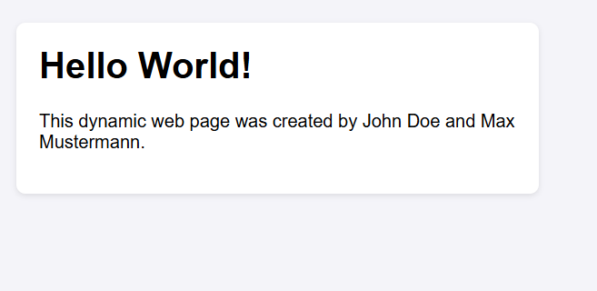
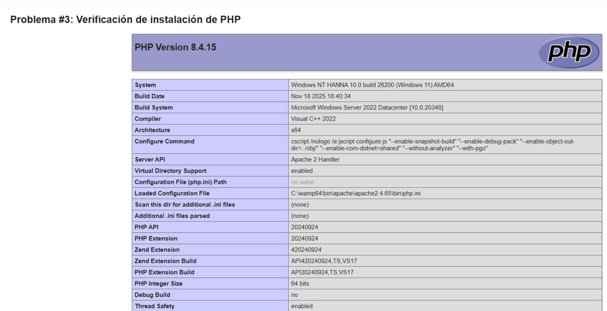
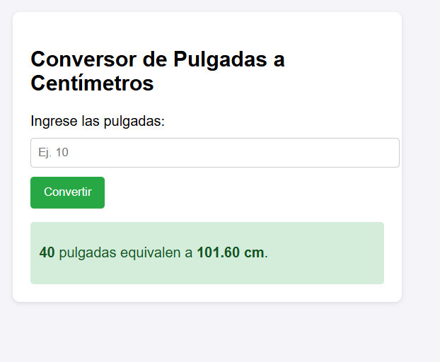
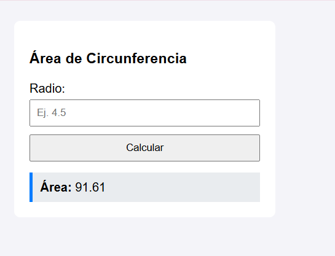
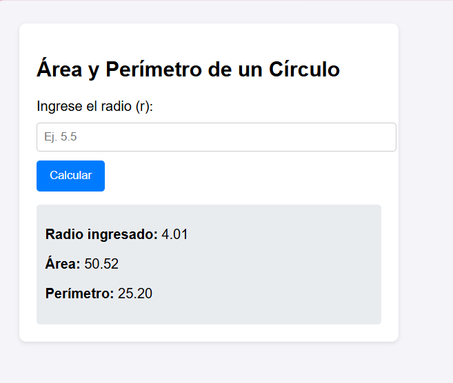

Universidad Tecnológica de Panamá Facultad de Sistemas Computacionales licenciatura en Ciberseguridad Estudiante: Hanna Licona Grupo: 1S3122 Profesora: Ing. Irina Fong 
# Prácticas PHP

Repositorio de ejercicios y prácticas en PHP.

## Tecnologías utilizadas
- **PHP** - Lógica del lado del servidor y procesamiento de datos
- **HTML** - Estructura de las páginas y formularios
- **CSS** - Estilos y diseño visual
- **JavaScript** - Interactividad y validaciones en el cliente

## Capturas

### Página dinámica de bienvenida

### Verificación de instalación de PHP

### Conversor de pulgadas a centímetros

### Área de una circunferencia

### Área y perímetro de un círculo

## Contenido

### Ejercicios Básicos
- **suma.php** - Suma de números
- **resta.php** - Resta de números
- **multiplicación.php** - Multiplicación de números
- **división.php** - División de números
- **potenciación.php** - Potencias
- **modulo.php** - Operación módulo
- **modulo2.2.php** - Variante del módulo
- **valor absoluto.php** - Valor absoluto de un número
- **redondeo.php** - Redondeo de números

### Cálculos Geométricos
- **Área de una circunferencia en C.php** - Cálculo del área de una circunferencia
- **Área y perímetro de un círculo.php** - Cálculo de área y perímetro de un círculo

### Conversiones
- **Conversión de pulgadas a centímetros.php** - Conversión de unidades

### Otros
- **calculadora.php** - Calculadora básica
- **formulario.php** - Ejemplo de formulario
- **variables.php** - Trabajo con variables
- **pagina2.php** - Página de ejemplo
- **lab1.php** - Laboratorio 1
- **lab2.php** - Laboratorio 2
- **lab3.php** - Laboratorio 3
- **cadenas.php** - problema 5

## Requisitos
- PHP 7.0 o superior
- Servidor web (XAMPP, WAMP, etc.)

## Uso
1. Clonar o descargar el repositorio
2. Colocar en la carpeta `www` de tu servidor
3. Acceder a través de `http://localhost/Practicas/`
